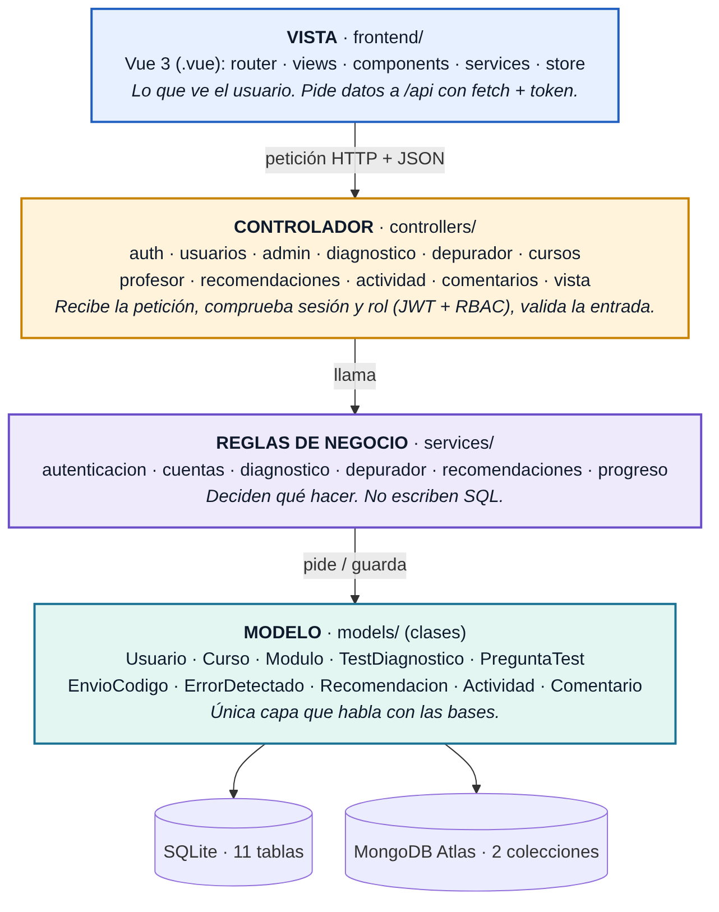
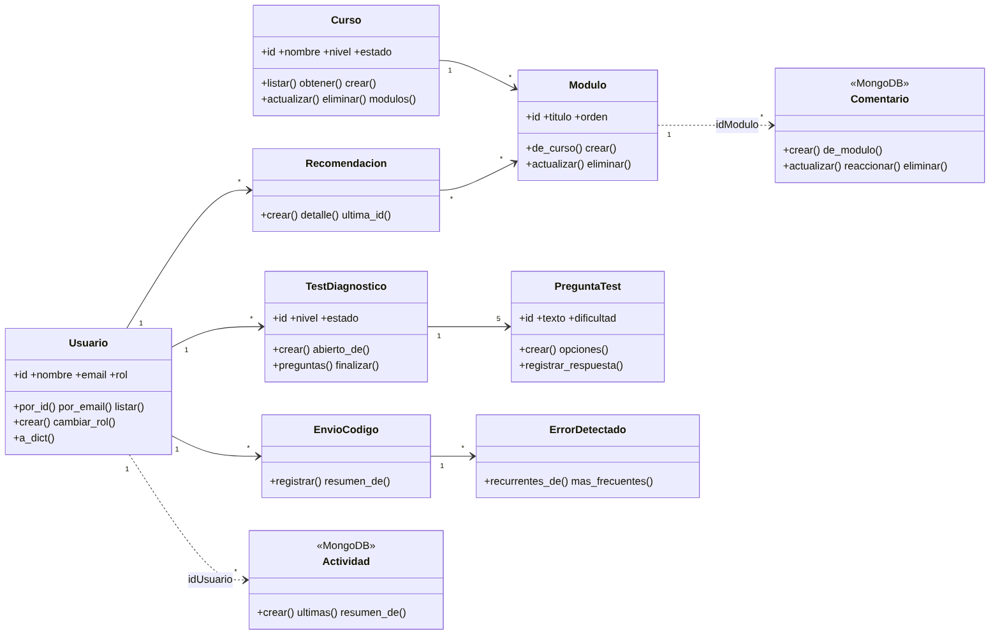
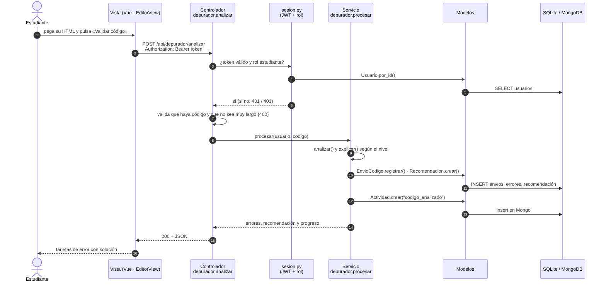

# Arquitectura MVC de EDUDEBUG

EDUDEBUG separa su código en **Modelo, Vista y Controlador**, más una capa de reglas de negocio entre el controlador y el modelo.



| Parte | Carpeta | Qué contiene | Qué NO hace |
|---|---|---|---|
| **Vista** | `frontend/` | Proyecto **Vue 3 + Vite** (`src/` con archivos `.vue`). Se compila a `frontend/dist/` y lo entrega `controllers/vista.py` | No toca las bases: pide todo a la API con `fetch` y el token. Está escrita en JavaScript, no en Python |
| **Controlador** | `controllers/` | Un archivo por recurso. Cada función es un endpoint `/api/...`: comprueba sesión y rol, valida la entrada y responde JSON | No escribe SQL ni tiene reglas de negocio |
| **Reglas de negocio** | `services/` | Diagnóstico adaptativo, depurador de HTML, recomendaciones, progreso, autenticación, cuentas, JWT y roles | No escribe SQL: pide los datos a los modelos |
| **Modelo** | `models/` | Clases que representan los datos y son **las únicas que hablan con SQLite y MongoDB** | No conoce HTTP ni Flask (salvo la conexión) |

## Cómo ver la vista
Con el servidor encendido (`python -m flask --app app run --debug`) abre **http://127.0.0.1:5000/**. Esa ruta (`GET /` en `controllers/vista.py`) entrega `frontend/dist/index.html`; el resto (JavaScript y CSS compilados) sale de `frontend/dist/assets/`. Dentro de la vista, cada pantalla tiene su ruta (ver más abajo). La documentación de la API está en **/api/docs**.

## Estructura de la vista (Vue 3)
```
frontend/
├── package.json          Dependencias (Vue, Vue Router, Bootstrap, Vite) y comandos npm
├── vite.config.js        Configuración de Vite (dev en :5173, build a dist/)
├── index.html            Página base: monta <div id="app">
├── dist/                 Resultado compilado (lo que entrega Flask). Se genera con npm run build
└── src/
    ├── main.js           Arranque: restaura la sesión y monta la app
    ├── App.vue           Solo contiene <router-view>
    ├── assets/estilos.css  Estilos
    ├── router/index.js   Las rutas de la vista y la protección por rol
    ├── services/api.js   ÚNICO lugar que llama a la API (/api) con el token JWT
    ├── store/            Estado compartido: sesion.js (usuario, rol, token, progreso), diagnostico.js
    ├── components/       Piezas reutilizables (.vue): NavDocente, PerfilCabecera, RecomendacionCaja
    └── views/            Una pantalla por ruta, un archivo .vue cada una (una vista = una responsabilidad)
```
Regla de la vista: una pantalla **no** hace `fetch` directo ni guarda reglas de negocio; llama a `services/api.js`, que habla con el Controlador, y las reglas viven en el backend.

### Ruta de cada pantalla (validación de interfaz)
| Ruta (`http://127.0.0.1:5000/#...`) | Pantalla (`views/`) | Quién entra | Endpoints que usa |
|---|---|---|---|
| `/` | `InicioView` | Público | — |
| `/login` | `LoginView` | Público | `POST /api/auth/login` |
| `/registro` | `RegistroView` | Público | `POST /api/usuarios/registro` |
| `/diagnostico` | `DiagnosticoView` | Estudiante | `POST /api/diagnostico/iniciar`, `/responder` |
| `/resultado` | `ResultadoView` | Estudiante | (usa lo que devolvió el diagnóstico) |
| `/curso/:id` | `CursoView` | Estudiante | `GET /api/cursos/<id>` |
| `/curso/:id/modulo/:orden` | `ModuloView` | Estudiante | `GET /api/cursos/<id>`, comentarios (`/api/modulos/<id>/comentarios`, MongoDB) |
| `/catalogo` | `CatalogoView` | Estudiante | `GET /api/cursos` |
| `/editor` | `EditorView` | Estudiante | `POST /api/depurador/analizar` |
| `/perfil` | `PerfilEstudianteView` | Estudiante | `GET /api/recomendaciones/<id>`, `GET /api/usuarios/<id>/perfil-completo` |
| `/panel` | `PanelProfesorView` | Profesor, admin | `GET /api/cursos`, `GET /api/profesor/progreso/<id>` |
| `/cursos` | `GestionCursosView` | Profesor, admin | `GET/DELETE /api/cursos`, `GET /api/cursos/<id>` |
| `/cursos/:id/modulos` | `ModulosCursoView` | Docente | `GET /api/cursos/<id>`, `DELETE /api/modulos/<id>` |
| `/cursos/:id/modulos/nuevo` y `/cursos/:id/modulos/:idModulo/editar` | `FormularioModuloView` | Docente | `POST /api/cursos/<id>/modulos`, `PUT /api/modulos/<id>` |
| `/cursos/nuevo`, `/cursos/:id/editar` | `FormularioCursoView` | Profesor, admin | `POST /api/cursos`, `PUT /api/cursos/<id>` |
| `/usuarios` | `AdminUsuariosView` | Solo admin | `GET/POST /api/admin/usuarios`, `PUT /api/admin/usuarios/<id>/rol` |
| `/perfil-docente` | `PerfilProfesorView` | Profesor, admin | — |

El router bloquea el acceso por rol (un estudiante que escribe `/#/panel` vuelve al catálogo); aun así el backend vuelve a validar el rol en cada endpoint.

### Flujo de la vista
`/` → `/login` → (el backend dice a dónde: estudiante nuevo → `/diagnostico` → `/resultado` → `/catalogo` → `/curso/:id` → `/curso/:id/modulo/:orden` → `/editor` ⇄ `/perfil`; profesor/admin → `/panel` ⇄ `/cursos` ⇄ `/usuarios`).

## Clases del modelo


| Clase | Archivo | Base | Tabla / colección |
|---|---|---|---|
| `Usuario` | `models/usuario.py` | SQLite | `usuarios` |
| `Curso`, `Modulo` | `models/curso.py` | SQLite | `cursos`, `modulos` |
| `TestDiagnostico`, `PreguntaTest` | `models/diagnostico.py` | SQLite | `tests_diagnosticos`, `preguntas_test`, `opciones_pregunta` |
| `EnvioCodigo`, `ErrorDetectado` | `models/envio.py` | SQLite | `envios_codigo`, `errores_detectados` |
| `Recomendacion` | `models/recomendacion.py` | SQLite | `recomendaciones`, `recomendacion_modulos`, `recomendacion_errores` |
| `Actividad` | `models/actividad.py` | MongoDB | `actividad_usuario` |
| `Comentario` | `models/comentario.py` | MongoDB | `comentarios_modulo` |

Infraestructura (no son entidades): `models/sqlite_db.py` (conexión, esquema y `transaccion()`) y `models/mongo_db.py` (conexión).

## Flujo de una petición
Ejemplo: el estudiante pulsa **«Validar código»** en el depurador.



1. La **vista** (`EditorView.vue`, a través de `services/api.js`) envía `POST /api/depurador/analizar` con el token.
2. El **controlador** `depurador.analizar` usa `requiere_sesion` (JWT y rol): sin sesión responde 401 y con otro rol, 403.
3. Valida que haya código y que no sea demasiado largo (400).
4. Llama al **servicio** `depurador.procesar`, que analiza el HTML, explica cada error según el nivel, y pide a los **modelos** guardar el envío (`EnvioCodigo.registrar`), generar la recomendación (`Recomendacion.crear`) y registrar la actividad en Mongo (`Actividad.crear`).
5. El controlador devuelve el JSON y la vista pinta las tarjetas de error.

## Recorrido de cada caso de uso
| Caso de uso | Endpoint | Controlador | Servicio | Modelos |
|---|---|---|---|---|
| CU-01 Registro | `POST /api/usuarios/registro` | `usuarios.registro` | `cuentas.registrar_estudiante` | `Usuario` |
| CU-01 Login | `POST /api/auth/login` | `auth.login` | `autenticacion.iniciar_sesion`, `limitador` | `Usuario`, `Actividad` |
| CU-02 Diagnóstico | `POST /api/diagnostico/iniciar` y `/responder` | `diagnostico.*` | `diagnostico` | `TestDiagnostico`, `PreguntaTest` |
| CU-03 Depurador | `POST /api/depurador/analizar` | `depurador.analizar` | `depurador.procesar` | `EnvioCodigo`, `Recomendacion`, `Actividad` |
| CU-04 Catálogo | `GET /api/cursos` | `cursos.listar` | — | `Curso` |
| CU-05 Panel del grupo | `GET /api/profesor/progreso/<id>` | `profesor.progreso_grupo` | `progreso.panel_profesor` | `Curso`, `Usuario`, `TestDiagnostico`, `ErrorDetectado` |
| CU-06 Cursos y módulos | `/api/cursos`, `/api/modulos` | `cursos.*` | — | `Curso`, `Modulo` |
| Usuarios y roles | `/api/admin/usuarios` | `admin.*` | `cuentas` | `Usuario` |
| Perfil completo (SQL + NoSQL) | `GET /api/usuarios/<id>/perfil-completo` | `usuarios.perfil_completo` | `cuentas.perfil_completo` | `Usuario`, `Actividad`, `Comentario` |
| Comentarios y actividad | `/api/comentarios`, `/api/actividad` | `comentarios.*`, `actividad.*` | `actividad` | `Comentario`, `Actividad` |

La tabla completa de los 33 endpoints, con el código obtenido por cada rol, está en [ENDPOINTS_VERIFICADOS.md](ENDPOINTS_VERIFICADOS.md).

## Verificación
* `python -m pytest -q` → 109 pruebas (incluye `tests/test_endpoints.py`, que recorre todas las rutas).
* `python -m scripts.verificar_endpoints --md docs/ENDPOINTS_VERIFICADOS.md` → regenera la tabla de endpoints (401 sin sesión, 403 rol equivocado, rol correcto sí entra).
* Regla de separación comprobable: `grep -rn "execute\|sqlite3" controllers services` no devuelve nada; todo el SQL está en `models/`.
